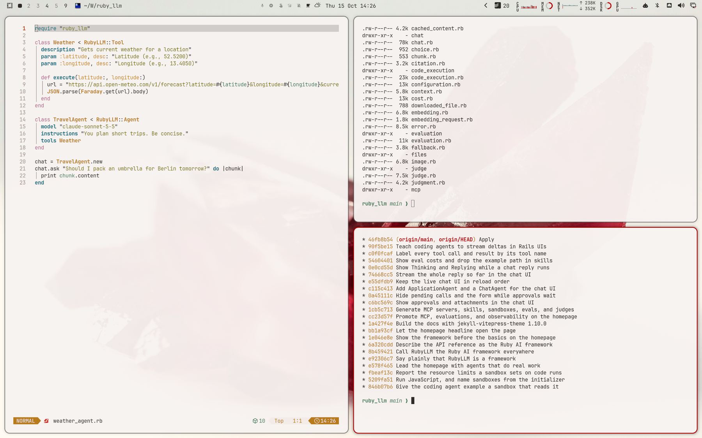

# RubyLLM Light for Omarchy Quattro

A warm, paper-toned theme sampled from the RubyLLM visual identity.



## Install

```bash
omarchy theme install https://github.com/crmne/omarchy-ruby-llm-light-theme.git
```

Activate it with:

```bash
omarchy theme set ruby-llm-light
```

## Architecture

This is a declarative Omarchy Quattro theme. It provides only:

- A semantic palette in `colors.toml`
- A GNOME icon theme choice in `icons.theme`
- Wallpapers in `backgrounds/`
- A selector preview in `preview.png`
- A RubyLLM boot unlock logo in `unlock.png`, with its selector preview in
  `preview-unlock.png`

Omarchy generates and applies the terminal, shell, Hyprland, editor, browser,
Obsidian, keyboard, and btop integrations from the semantic palette. The theme
contains no executable hooks, package installation, or application-specific
configuration files.

## Core colors

Sampled from the rubyllm.com design tokens. The ANSI colors follow the
Gruvbox palette the site uses for code.

- Background: `#f7f3f1`
- Surface: `#faf9f7`
- Section tint: `#f3ece7`
- Foreground: `#2c2926`
- Secondary text: `#5c5353`
- Muted text: `#796b67`
- Ruby red: `#b30000`
- Bright ruby: `#c9271e`

## Wallpapers

- `01-rubyllm-gem.jpg`: The RubyLLM gem on the homepage grid, made for this theme
- `02-rubyllm-bubbles.jpg`: The RubyLLM pixel chat bubble, made for this theme
- `03-ruby-crystal.jpg`: [Jason D](https://unsplash.com/photos/VKLJ-BJlszE) on Unsplash
- `04-white-lines.jpg`: [H&CO](https://unsplash.com/photos/1kJwc8-98Nk) on Unsplash
- `05-red-door.jpg`: [Marion Mesbah](https://unsplash.com/photos/gyWIBOqVL8Q) on Unsplash
- `06-sand-crest.jpg`: [Brandon Smith](https://unsplash.com/photos/3fN13Uap0d4) on Unsplash

Photos are used under the [Unsplash License](https://unsplash.com/license).

## Requirements

Omarchy 4 (Quattro) or newer.

## License

[MIT](LICENSE)
